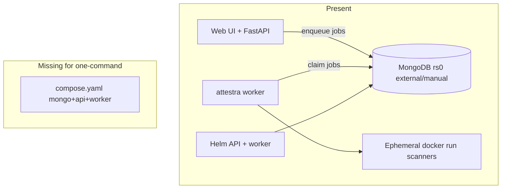

# Attestra Docker Infrastructure Audit

Baseline inventory and gap register for one-command Docker deployment. Produced after full-repo Phase 0 discovery and Phase 1 parallel specialist audits (2026-11-10). Implementation status below is the baseline at audit time; later phases update gaps as work lands.

Detailed evidence lives in:

- [[docs/audit/DOCKER_AUDIT.md]]
- [[docs/audit/DATABASE_AUDIT.md]]
- [[docs/audit/WORKER_AUDIT.md]]
- [[docs/audit/SCANNER_INTEGRATION_AUDIT.md]]
- [[docs/audit/COMPLIANCE_AUDIT.md]]
- [[docs/audit/API_INTEGRATION_AUDIT.md]]
- [[docs/audit/DEPLOYMENT_TEST_PLAN.md]]

---

## Current architecture

Attestra is a FastAPI security-testing and compliance platform with MongoDB-only runtime persistence (replica set required for transactions), a durable job worker (`attestra worker`), digest-pinned ephemeral scanner containers, and a compliance catalogue (hub + packs). Production deploy path today is **Helm** (API + worker) against an **external** MongoDB. Local develop typically uses a host venv plus a manually started `mongo:7` container.

There is **no** `compose.yaml` / `docker-compose*.yml`. The root `Dockerfile` builds one image for API (default CMD) and worker (command override). Scanners are not bundled in the app image.



---

## Service inventory

| Service / artifact | Status | Notes |
| --- | --- | --- |
| Root `Dockerfile` | Present, **build broken** | `.[postgres]` extra removed; `alembic.ini` missing |
| `.dockerignore` | Present | Excludes tests/docs/deploy |
| Compose stack | **Absent** | Blocks one-command deploy |
| Helm chart `deploy/helm/attestra` | Present | API + worker; Mongo external |
| K8s scanner Job templates | Present | Worker Job spawn **not** implemented |
| Local Mongo | Manual `mongo:7 --replSet rs0` | See `docs/mongodb_migration/SECURE_LOCAL_MONGO.md` |
| Temporal | Optional code path | Not composed; needs `.[temporal]` |
| Keycloak / Vault / observability | Stubs / examples | Not required for core compose |
| CI `.github/workflows/ci.yml` | Present, **Postgres-shaped** | Installs missing `postgres` extra; no Mongo service |

---

## Worker inventory

| Worker | Entry | Queue | Docker need |
| --- | --- | --- | --- |
| Durable scan worker | `attestra worker` | Mongo `jobs` | Same app image; Docker socket or future K8s Jobs for scanners |
| Temporal worker | same CLI when `ATTESTRA_ORCHESTRATOR=temporal` | Temporal + Mongo job rows | Optional Temporal server |
| Scheduled scans | Worker housekeeping `enqueue_due_schedules` | → scan jobs | Covered by worker |
| Automated VAPT | Worker claim when flag on | `AutomatedTestExecution` | Flag **off** by default |
| Webhook dispatch | **Not** in worker; API/cron | Separate queue | Needs cron or worker hook (WORKER-G01) |
| Ops CLI (`purge`, `cert-expiry-check`, …) | One-shot CLI | N/A | External schedule (WORKER-G02) |

API path: auth → gate/scope → credits → `request_scan` → Mongo enqueue → worker `run_one_job` → import → persist.

---

## Database dependency inventory

| Item | State |
| --- | --- |
| Runtime | MongoDB only (`bootstrap.init_persistence`, `MongoSession`) |
| Default URI | `mongodb://…/?replicaSet=rs0` |
| SQLAlchemy | Schema/query builder for MongoSession; intentional |
| Alembic sources | **Gone** (pycache only); Dockerfile still copies them |
| GridFS | Artifact store when `ATTESTRA_STORAGE=mongo` |
| Tenant isolation | Application-level (`scoped` / engagement access); not Mongo RLS |
| Replica-set init in repo | **Missing** for Compose/Helm |

---

## Scanner inventory (summary)

| Category | Tools |
| --- | --- |
| Runner + importer (Docker or binary) | ZAP, Nuclei, Trivy, Semgrep, testssl, Gitleaks, Checkov, Naabu, WebCheck |
| Incomplete Docker path | Prowler, kube-bench (local only) |
| Import-only | Observatory, SSL Labs, Burp, Nessus, SARIF, CycloneDX, Dependency-Track |
| Stub / config-only | OpenVAS, MobSF |
| Image pins | `ATTESTRA_IMAGE_*` placeholders until operator sets real digests |

Do not install every scanner into the app image. Prefer digest-pinned per-tool images invoked by the worker.

---

## Compliance framework inventory

All ten IDs load via `load_library()` when package data is present:

`pci_dss_4`, `iso_27001_2022`, `soc2`, `asvs_4_0`, `cert_in_2022`, `dora_2022`, `iso_42001_2023`, `nist_csf_2`, `rbi_csf_2016`, `sebi_cscrf_2024`.

Risk: `reports/data/template_config.yaml` not in setuptools package-data (COMPLIANCE-G01) → missing from wheel/Docker image.

---

## API / security inventory

- Auth: API keys, sessions, optional OIDC; RBAC via `require(permission)`.
- SSRF: DNS pinning + safe HTTP + blocked CIDRs + engagement scope.
- Health: `GET /api/health` (Mongo ping; HTTP 200 even when degraded).
- Docker HEALTHCHECK currently hits `/` (wrong readiness signal).
- Automated VAPT disabled by default; must stay that way in compose defaults.

---

## Target Docker architecture (lead decision)

One Compose project, separate containers, no monolith:

| Service | Image / build | Role |
| --- | --- | --- |
| `mongo` | `mongo:7` | Replica set `rs0`, named volume, publish `127.0.0.1:27017` only |
| `mongo-init` | same mongo image | One-shot `rs.initiate` when needed |
| `api` | build root `Dockerfile` | `attestra serve`; depends on healthy mongo; runs init on start or via one-shot `init` service |
| `worker` | same image | `attestra worker`; Docker socket mount for scanner `docker run` (dev/compose); same Mongo URI |
| Optional profiles | — | `temporal`, observability — documented, not default |

Preferred layout:

```text
compose.yaml
.dockerignore
.env.example
docker/
  mongo-init/init-replica-set.js
  scripts/healthcheck-api.sh
  scripts/wait-for-mongo.sh
Dockerfile   # fixed build
```

Primary UX: `docker compose up -d --build`.

---

## Consolidated gap register

Critical path for Phase 2–3 marked ★. Status updated after implementation + Compose acceptance (2026-11-10).

| Gap ID | Component | Required change | Status |
| --- | --- | --- | --- |
| ★ DOCKER-G01 | Dockerfile | `pip wheel "."` | **Done** (build verified) |
| ★ DOCKER-G02 | Dockerfile | Drop alembic/migrations COPY | **Done** |
| ★ DOCKER-G03 | Compose | Root `compose.yaml` mongo+api+worker | **Done** (`docker compose up -d --build` verified) |
| ★ DOCKER-G04 | Health | HEALTHCHECK → `/api/health` | **Done** |
| DOCKER-G05 | Mongo defaults | Auth for shared/prod | Partial (loopback + docs; local compose still unauthenticated) |
| ★ DOCKER-G06 | CI | Mongo rs0 + `.[dev]` + image build job | **Done** |
| DOCKER-G07 | Helm NP | Egress CIDRs | Pending (Helm path) |
| DOCKER-G08 | Mongo service | Compose mongo | **Done** |
| DOCKER-G09 | Worker health | Compose healthcheck | **Done** (import check); InstanceLock container restart **Done** |
| WORKER-G01 | Webhooks | Drain in worker/cron | Pending |
| WORKER-G05 | Scanner images | Document pins in `.env.example` | **Done** (docs); pins still operator-supplied |
| ★ COMPLIANCE-G01 | package-data | `reports/data/*.yaml` | **Done** (verified in image) |
| COMPLIANCE-G02 | `FRAMEWORKS` tuple | Align with catalogue | Pending |
| DATABASE init | Replica scripts | `docker/mongo-init` | **Done** for Compose |
| TEST-G01 | Compose smoke | Manual Phase 10 subset | Partial (manual pass; CI automation still light) |

Full per-agent gap tables remain authoritative in `docs/audit/*`.

---

## Broken connections / duplicates

- Dockerfile host `mongo` never defined without Compose/Helm networking.
- CI Postgres vs runtime Mongo.
- SETUP_GUIDE / LOAD_TEST / RELEASE docs still mention SQLite/Postgres paths.
- Helm “Temporal worker” documented without template switch.
- `lat.md` “Helm deferred” conflicts with existing chart.

---

## Missing environment variables (for `.env.example`)

Beyond current template, Compose operators need documented:

- `ATTESTRA_MONGODB_URI` / `ATTESTRA_MONGODB_DB` (compose service DNS)
- `ATTESTRA_SESSION_SECRET`, `ATTESTRA_API_KEY_PEPPER` (required non-default in shared envs)
- `ATTESTRA_WORKER_CONCURRENCY`
- `ATTESTRA_IMAGE_ZAP|TRIVY|NUCLEI|SEMGREP|TESTSSL|NAABU|GITLEAKS|CHECKOV`
- `ATTESTRA_SCANNER_CACHE_DIR`, `ATTESTRA_SCANNER_TIMEOUT_S`
- `ATTESTRA_ORCHESTRATOR`, `ATTESTRA_AUTOMATED_VAPT_ENABLED=false`
- `ATTESTRA_STORAGE`, GridFS bucket
- Feature flags: auth-web, subscription, bypasses (local only)

---

## Security constraints (must preserve)

Signed authorization, engagement scope, ownership verification, SSRF/DNS pinning, tenant isolation, RBAC, evidence hashing, secret encryption, scanner scope safeguards. Automated VAPT remains **disabled** unless explicitly enabled. No public Mongo by default. No arbitrary scan targets from worker network access alone.

---

## Required infrastructure changes (implementation order)

1. Fix Dockerfile build (G01/G02) and HEALTHCHECK (G04).
2. Add `reports/data` to package-data (COMPLIANCE-G01).
3. Add `docker/mongo-init` + `compose.yaml` (mongo, init, api, worker).
4. Expand `.env.example`.
5. Align CI to Mongo; optional image build smoke.
6. Worker connectivity validation matrix (Phase 4).
7. Compliance catalogue smoke in container (Phase 5).
8. Health/restart acceptance (Phases 7/10).
9. README rewrite last (Phase 9), only after verified commands.

---

## Validation evidence (baseline)

- Recursive search: no compose files; single root `Dockerfile`.
- `pyproject.toml`: no `postgres` optional extra; `pymongo` in base deps.
- `Test-Path alembic.ini` → False; `migrations/versions` pycache-only.
- Specialist audits completed under `docs/audit/` (seven files).
- Health route: `attestra/api.py` `GET /api/health`.
