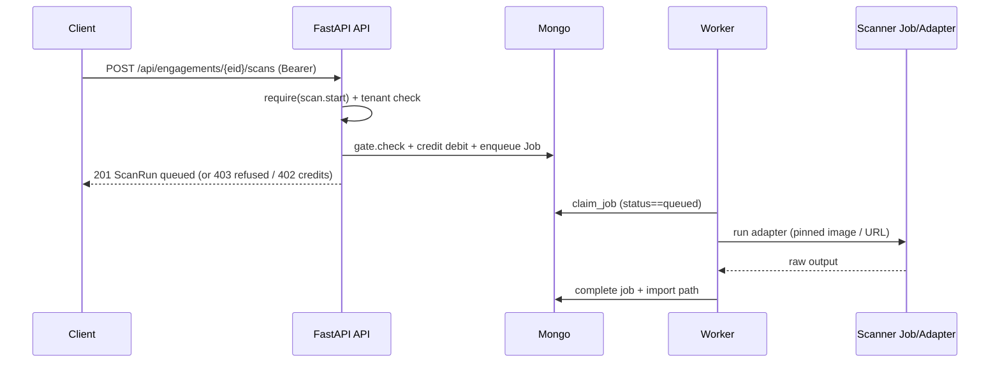

# API, Security & Integration Audit

**Agent:** API / Security / Integration Engineer  
**Scope:** FastAPI startup, route registration, auth/RBAC, tenant isolation, internal service connections, DB session lifecycle, API↔worker/storage/scanner communication, CORS, rate limits, SSRF, DNS pinning, scope validation, health/readiness, shutdown.  
**Method:** Code and deploy inspection only (no application code changes). Grounded with `lat search "API authentication health SSRF"` and related searches.  
**Date:** 2026-11-10

---

## 1. Architecture of API startup

### 1.1 Entrypoint and process model

| Layer | Location | Behavior |
| --- | --- | --- |
| CLI serve | `attestra/cli.py#cmd_serve` | `config.validate_runtime_config()` then `uvicorn.run("attestra.api:app", host, port, reload=False)` |
| Default Docker CMD | `Dockerfile` | `attestra serve --host 0.0.0.0 --port 8000`; image also runs worker via `attestra worker` |
| Helm API | `deploy/helm/attestra/templates/api-deployment.yaml` | Init container `attestra init`, then same serve command; port from `values.api.port` (8000) |

One image, two roles (API vs worker). Scanners are **not** bundled; they run as separate digest-pinned Jobs (K8s) or local adapters claimed by the worker.

### 1.2 FastAPI factory and lifespan

Evidence: `attestra/api.py` (module-level `app`, `lifespan`).

```
validate_runtime_config()  →  init_persistence(use_migrations=True)  →  yield  →  (no teardown)
```

- `@asynccontextmanager async def lifespan`: calls `config.validate_runtime_config()` then `bootstrap.init_persistence(use_migrations=True)`.
- `bootstrap.init_persistence` → Mongo only (`attestra/persistence/mongo/client.py#init_mongo`), creates dirs, applies Mongo schema migrations, fails fast on unreachable Mongo (`admin.command("ping")`).
- Middleware registered at import time (before serve):
  - `SecurityHeadersMiddleware`
  - `RateLimitMiddleware`
  - optional `observability.MetricsMiddleware` when `ATTESTRA_METRICS_ENABLED`
- `observability.configure_json_logging()` and `observability.setup_otel(app)` run at import.
- **No** `CORSMiddleware` and **no** lifespan cleanup calling `close_client()`.

### 1.3 Route registration

Core routes live on `app` in `attestra/api.py`. Additional routers are mounted late in the same module:

| Router | Package |
| --- | --- |
| UI / portal / tickets / AI | `web.ui`, `web.portal`, `integrations.routes`, `web.ai_routes` |
| Proof / webhooks / users / alerts | `proof`, `webhooks`, `users`, `alerts` |
| CA / ownership / org ownership | `certification`, `ownership_settings`, `org_ownership` |
| Trust / library / share | `trust`, `library`, `share` |
| Auth-web / automated VAPT / SEBI / verify | `auth_web.routes`, `automated_vapt.routes`, `web.sebi_routes`, verify public |

OpenAPI at `/docs` / `/redoc` (CSP relaxed for jsDelivr on those paths only).

### 1.4 Request → persistence session lifecycle

| Path | Seam | Lifecycle |
| --- | --- | --- |
| Domain API handlers | `data_access.session()` → `db.session()` → `MongoSession` | Context manager: commit on success, rollback on exception (`attestra/db.py#session`) |
| Identity (Bearer / cookie) | `data_access.identity_session()` | Yields `None`; auth reads Mongo via `mongo_service` / collections directly |
| Helper `_run(fn, …)` | Opens `data_access.session()`, maps `LookupError`→404, `ServiceError`→403/409 | Used by most JSON endpoints |

Tenant filter context: `db.current_tenant_ids` / `db.tenant_scope` exist for optional ContextVar scoping; API routes primarily call `services.get_engagement(..., principal)` / `assert_engagement_access`.

### 1.5 How jobs are admitted from the API

Flow for `POST /api/engagements/{eid}/scans` (`scan.start`):

1. `services.get_engagement(s, eid, principal)` — tenant + existence.
2. `services.request_scan(...)` (`attestra/services.py#request_scan`):
   - Optional auth-profile tenant/engagement checks.
   - Fail-fast credit exhaustion when `SUBSCRIPTION_SERVICE=ON`.
   - **Dispatch gate** `runner.gate.check` (OPA/policy facts + authorize + pin) — refusal → `ScanRun(status=refused)` returned; API maps to **403**.
   - On accept: `consume_for_scan_admit` → create `ScanRun(status=queued)` → `jobs.durable.enqueue` → `orchestration.dispatch_scan`.
   - Pre-start failure refunds credits; audit `scan.request`.
3. Worker process (`attestra worker`) claims Mongo jobs (`claim_job` conditional update on `status==queued`), runs scanner adapters, heartbeats, cancel via Events / stop file.

API does **not** execute scanners inline. Communication is **Mongo-backed job queue** (+ optional Temporal when `ATTESTRA_ORCHESTRATOR=temporal`). Shared `/data` volume for local artifacts when storage is not GridFS/S3.

Automated VAPT admits similarly by queuing `QUEUED` executions for the same worker (`automated_vapt` routes / orchestrator), not in the HTTP request.



---

## 2. Auth / RBAC summary

### 2.1 Identity resolution

`attestra/api.py#get_principal`:

1. `Authorization: Bearer …` → `data_access.authenticate_bearer` (API key HMAC with pepper from env/Vault).
2. If key miss and `ATTESTRA_OIDC_ENABLED` → `auth.oidc.authenticate_bearer_jwt` (Keycloak access tokens / JWKS).
3. Else `attestra_session` cookie → `auth.session.read_session` → `principal_for_uid` (active user only).
4. Else **401** `authentication required`.

Passwords: scrypt (`auth/keys.py`). UI login in `web/ui.py`. Report four-eyes uses distinct user ids (reports layer).

### 2.2 Roles and permissions

Six roles in `attestra/auth/roles.py#ROLES`:  
`admin`, `lead`, `tester`, `reviewer`, `client_viewer`, `auditor`.

`require(permission)` → `has_permission(role, permission)` or **403**. Unknown permissions deny. Notable permissions:

| Permission | Roles (high level) |
| --- | --- |
| `engagement.create` | admin, lead |
| `scan.start` / `scan.read` | start: admin/lead/tester; read adds reviewer/auditor |
| `authorization.document` | **admin only** (signed auth file bytes) |
| `compliance.confirm` | admin, auditor |
| `credits.allocate` / `certification.manage` / `ownership.configure` / `user.manage` | admin |
| `portal.evidence` / `portal.retest_request` | includes `client_viewer` without `finding.write` |
| `auth_profile.manage` | admin, lead |

Lat snapshot: [[lat.md/authorization#Identity]], [[lat.md/authorization#Tenant isolation]].

### 2.3 Tenant isolation

- `services.tenant_ids_for` / `scoped` / `assert_engagement_access`: non-admin principals limited to home tenant + memberships; missing engagement → **404** (not 403) to avoid cross-tenant existence leaks on engagement paths.
- Credits endpoints additionally check `_credits_tenant_allowed` (admin or matching `principal.tenant_id`).
- Evidence/imports/reports under `DATA_DIR/tenants/<id>/` (and GridFS when `ATTESTRA_STORAGE=mongo`).
- Finding-id write routes call `assert_engagement_access` before mutate.
- Webhook/workflow creates require tenant row existence even when lead/admin is unrestricted (`tenant_ids_for` None ≠ skip existence).

### 2.4 Public / lightly gated surfaces

Unauthenticated (by design): `GET /api/health`, `GET /api/catalog`, `GET /api/frameworks`, `GET /api/profile/catalogues`, share/trust/verify public routers, login UI.  
`/metrics` gated by `ATTESTRA_METRICS_TOKEN` / anon allow / admin session (`observability.py`).

---

## 3. Security controls inventory

| Control | Status | Evidence |
| --- | --- | --- |
| Bearer API keys (peppered HMAC) | Present | `auth/keys.py`, `secret_store` for `api_key_pepper` |
| Signed session cookies | Present | `auth/session.py`, `ATTESTRA_SESSION_SECRET` |
| Optional OIDC JWT | Present (flagged) | `ATTESTRA_OIDC_*`, Helm `oidc.*` |
| RBAC permission map | Present | `auth/roles.py` + `require()` |
| Tenant query scoping | Present | `services.scoped`, `assert_engagement_access` |
| Security headers (CSP, XFO, nosniff, referrer) | Present | `api_security.SecurityHeadersMiddleware` |
| API rate limit (sliding window) | Present (in-process) | `RateLimitMiddleware`; key = Bearer prefix or client IP; default `ATTESTRA_API_RATE_LIMIT=120` / 60s |
| Per-asset scan rate | Present | `ATTESTRA_SCAN_RATE_PER_ASSET` in gate/policy |
| Signed authorization import/scan gate | Present | `signed_authorization_required` / local bypass via `APP_ENV` + `BYPASS_*` |
| Target ownership gate | Present | DNS TXT / `attestra-verify.txt` / private owner-confirm; bypass allowlisted |
| Scope authorize (URL/path/image/host + deny rules) | Present | `runner/authorization.py#authorize_target`, `scope_for_engagement` |
| SSRF IP policy | Present | `BLOCKED_CIDRS` (0.0.0.0/8, 100.64/10, link-local, `fd00:ec2::254`), loopback blocked, non-global denied unless allow_private |
| DNS / IP pinning | Present | `runner/dns_pin.py#pin_url` (resolve once, validate, prefer IPv4); NAT64 duplicate drop |
| Safe HTTP client | Present | `runner/http_safe.py#safe_request` — pin + re-authorize every redirect, body cap |
| Auth-web crawl SSRF/scope | Present | `auth_web/scope.py` reuses IP policy + optional resolve |
| OPA scope policy | Present | `policy/scope.rego` via `runner/policy` + `gate.check` |
| Digest-pinned scanner images | Present | `config.require_image_digest` / `ATTESTRA_IMAGE_*` |
| Evidence size / path containment | Present | `EVIDENCE_MAX_BYTES`, `path_under_roots` |
| NetworkPolicy (Helm) | Present (optional) | App ingress only API port; egress DNS + `appEgressCIDRs`; scanner Job egress to pinned IP |
| CORS allowlist middleware | **Absent** | No `CORSMiddleware` / `ALLOWED_ORIGINS` in app code |
| Shared/distributed rate limit | **Absent** | Per-process memory only |
| Graceful API Mongo shutdown | **Absent** | Lifespan has no post-yield `close_client()` |
| Separate readiness vs liveness HTTP | **Partial** | Single `/api/health`; K8s uses TCP; Docker HEALTHCHECK hits `/` |

### 3.1 SSRF / scope / DNS pinning (detail)

- Gate collects policy input (window, auth environments, intrusive flag, ownership, rate) then Python still `authorize_target` + `pin_url` before dispatch (`runner/gate.py`).
- Connect address is the **pinned IP** with original Host/SNI (`PinnedTarget`).
- Auth-web and ownership well-known GETs go through the same SSRF/scope posture (ownership file fetch only when target is authorized/in scope).
- Scanner NetworkPolicy example documents egress **only** to the pinned `/32` (`deploy/helm/.../scanner-networkpolicy.yaml` pattern; `values.scanner.pinnedIP`).

### 3.2 CORS

Application **serves** same-origin HTML UI + JSON API from one process. There is **no** Starlette/FastAPI CORS middleware configuring cross-origin browser API access. CORS appears in the product as **finding classification** (Observatory/ZAP), not as an API ingress control. If a separate SPA origin is introduced, CORS must be added explicitly.

### 3.3 Rate limits

- API: in-memory sliding window on `/api/*` (`api_security.py`). Multi-replica deployments do not share counters.
- Scans: `enforce_scan_rate` / gate `SCAN_RATE_PER_ASSET`.
- Auth-web crawl: `AUTH_WEB_RATE_PER_HOST`, concurrency/duration caps.

---

## 4. Health endpoints

| Endpoint | Auth | Behavior |
| --- | --- | --- |
| `GET /api/health` | None | Returns JSON: `status` (`ok` or `degraded`), `version`, `pdf` / `pdf_engine` / `pdf_message`, `persistence: mongo`, `mongo` ping payload or `{ok:false,error}`. **HTTP status remains 200** even when Mongo probe fails (`status: degraded`). |
| `GET /metrics` | Token / anon flag / admin | Prometheus text; 404 if metrics disabled |
| Docker `HEALTHCHECK` | N/A | `urllib` GET `http://127.0.0.1:8000/` (UI root), **not** `/api/health` |
| Helm readiness/liveness | N/A | `tcpSocket` on API port — does not evaluate Mongo/PDF |

No `/ready`, `/live`, or `/healthz` aliases found.

---

## 5. Internal service connections (API perspective)

| Dependency | How API talks to it | Required for start? |
| --- | --- | --- |
| MongoDB | `init_mongo` at lifespan; all domain/identity data | **Yes** (ping fail aborts startup) |
| GridFS / local / S3 storage | Via storage backend config after start | Mongo GridFS default; S3 needs bucket/endpoint env |
| Worker | Indirect: Mongo job documents; live-status reads launcher/worker status | Not required for API process start; required for scans to run |
| Scanner containers/Jobs | Created/run by worker, not API HTTP | Digests via env; not in API image |
| Keycloak / OIDC | Optional JWT validation when enabled | Optional |
| Vault/OpenBao | Optional secrets backend | Optional (`ATTESTRA_SECRETS_BACKEND`) |
| Temporal | Optional orchestrator | Optional |
| SMTP / webhooks egress | Alerts/webhooks modules | Optional; NetworkPolicy must allow destinations |
| OPA | Embedded Rego evaluation in-process | Bundled policy files |

---

## 6. Docker / Helm requirements for the API service

### 6.1 Image and ports

- Build: `docker build -t attestra:dev .`
- Expose **8000**
- User **10001:10001**, volume `/data` (`ATTESTRA_DATA_DIR=/data`)
- Default env in image: `ATTESTRA_PERSISTENCE=mongo`, `ATTESTRA_STORAGE=mongo`, `ATTESTRA_MONGODB_URI=mongodb://mongo:27017/?replicaSet=rs0`, `ATTESTRA_MONGODB_DB=attestra`

### 6.2 Required / strongly recommended environment

| Variable | Role |
| --- | --- |
| `ATTESTRA_MONGODB_URI` | Required reachable replica-set (or transactional) URI; authenticated in production |
| `ATTESTRA_MONGODB_DB` | DB name (default `attestra`) |
| `ATTESTRA_API_KEY_PEPPER` | Required in Helm Secret for non-dev |
| `ATTESTRA_SESSION_SECRET` | Required in Helm Secret for non-dev |
| `ATTESTRA_STORAGE` | `mongo` \| `local` \| `s3` |
| `APP_ENV` | `local`/`test`/`development`/`staging`/`production`; bypass flags only on allowlist |
| `SUBSCRIPTION_SERVICE` | `ON`/`OFF` (credits only; does not disable auth/SSRF) |
| `ATTESTRA_PUBLIC_URL` | Absolute links in alerts/emails |
| Optional OIDC / metrics / OTEL / scanner digests / Fernet credential key | As features enabled |

Startup **rejects** bypass flags when `APP_ENV` is missing (if bypass requested), unknown, or `staging`/`production` (`validate_runtime_config`).

### 6.3 Depends-on / co-services

There is **no** root `docker-compose.yml` in-repo. Operational composition:

| Service | Relationship to API |
| --- | --- |
| MongoDB replica set | Hard dependency at lifespan |
| Worker Deployment/process | Soft for HTTP; hard for scan completion; Helm `worker.replicas: 1` (InstanceLock) |
| Shared PVC `/data` | Helm mounts same data volume pattern for API (+ worker) when local files used |
| Init `attestra init` | Helm initContainer before API |

**Effective depends_on for a working API that can admit scans:** Mongo healthy **and** at least one worker sharing the same Mongo (and storage config). API alone will serve health/UI/REST but scans stay queued.

### 6.4 NetworkPolicy caveat

When `networkPolicy.enabled=true` (default in values), API/worker egress is DNS + `appEgressCIDRs` only. **Empty `appEgressCIDRs` blocks Mongo/OIDC/SMTP** unless the CNI path is adjusted. Operators must list Mongo (and other) CIDRs.

---

## 7. Gaps (API-G…)

| ID | Severity | Gap | Evidence / impact |
| --- | --- | --- | --- |
| **API-G01** | Medium | No CORS middleware / origin allowlist | Same-origin design today; separate frontend origin would fail browser CORS or need reverse-proxy only |
| **API-G02** | Medium | `/api/health` returns HTTP 200 when Mongo is degraded | Orchestrators treating 200 as ready may route traffic to a broken API |
| **API-G03** | Medium | Probe mismatch: Docker HEALTHCHECK uses `/`; Helm uses TCP; neither requires Mongo/`/api/health` | Container can be “healthy” while persistence is down (after start) or while only port is open |
| **API-G04** | Low | Lifespan does not close Mongo client on shutdown | Relies on process exit; no explicit drain/close (`close_client` unused by API lifespan) |
| **API-G05** | Medium | Rate limit is per-process memory | Horizontal API scale multiplies effective limit; no Redis/global limiter |
| **API-G06** | Low | No first-party docker-compose for API+Mongo+worker | Operators must assemble from Dockerfile + external Mongo docs / Helm |
| **API-G07** | High (when NP on) | Default empty `appEgressCIDRs` with NetworkPolicy enabled | API/worker can be prevented from reaching Mongo unless CIDRs configured |
| **API-G08** | Low | Health does not report worker/queue/storage readiness | Ops cannot distinguish “API up” from “platform can run scans” without `/live-status` or worker metrics |
| **API-G09** | Info | `/api/catalog` and framework catalogues are unauthenticated | Intentional for UX; confirm threat model accepts anonymous catalogue disclosure |
| **API-G10** | Info | ZAP/scanner runtime egress confinement is NetworkPolicy/Job-side; API only pre-pins | Documented elsewhere as runner concern; API admit path pins before enqueue |

---

## 8. Verification notes (tests / lat)

- `lat search "API authentication health SSRF"` hits health assertions in [[lat.md/tests#test_api.py]], SSRF scope tests, and authorization sections.
- `tests/auth/test_api_security.py`: security headers on `/api/health`; rate limiter 429 behavior.
- Identity/RBAC/tenant matrix covered under Phase 2 auth tests (lat `tests.md`).

---

## 9. Summary

Attestra’s API is a single FastAPI app (`attestra.api:app`) started by `attestra serve` / Docker CMD / Helm, with a lifespan that **fail-closes on Mongo init** and validates runtime bypass/subscription flags. Identity is Bearer API key, session cookie, or optional OIDC; RBAC is a fixed six-role permission map; tenant isolation is enforced in services before domain work. Scan admission is gate → credit → Mongo job enqueue → worker claim; SSRF defenses combine scope authorize, blocked CIDRs, DNS pinning, and redirect-safe HTTP. Security headers and an in-process API rate limiter are on; **CORS is not**. Health is a single unauthenticated `/api/health` that can mark Mongo degraded without failing HTTP status, while Docker/Helm probes do not consume that body. For Docker, the API needs Mongo (replica set), secrets (pepper/session), port 8000, `/data`, and—for end-to-end scans—a co-deployed worker plus correctly opened egress to Mongo when NetworkPolicies are enforced.

**Primary follow-ups:** align probes with readiness semantics (**API-G02/G03**), set Helm egress CIDRs (**API-G07**), and decide CORS + distributed rate limiting if the API is ever split across origins or many replicas (**API-G01/G05**).
