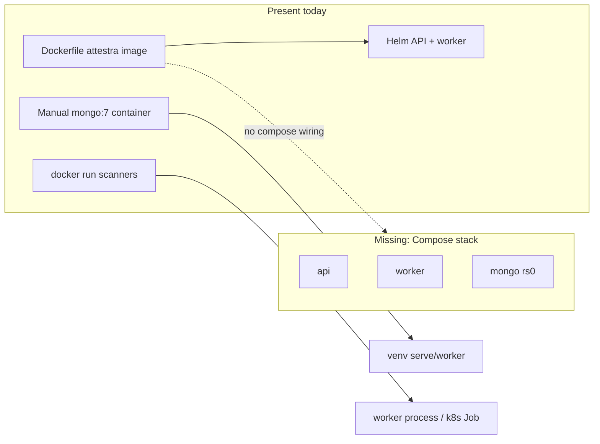

# Attestra Docker & Deploy Audit

**Agent:** AGENT 1 — Docker and DevOps Architect  
**Scope:** Read-only inventory of Dockerfiles, Compose, Helm/k8s, CI, env templates, and runtime image-related deps.  
**Write target:** this file only. No Dockerfiles, Compose, Helm, or application code were modified.  
**Date:** 2026-11-10  

**Lat grounding:** `lat search "docker compose deployment"` surfaced runner Docker scanner execution (`lat.md/runner.md#Scanner runs`), not a Compose stack. Architecture notes Mongo-only runtime (`lat.md/architecture.md#MongoDB migration (in progress)`) while “Still deferred” still lists Helm as later-phase — that conflicts with the implemented chart under `deploy/helm/attestra/`.

---

## 1. Current Docker architecture overview

Attestra today is **not** a Docker Compose application. There is **no** `compose.yaml`, `compose.yml`, or `docker-compose*.yml` anywhere in the repository.

What exists instead:

| Layer | Role | Evidence |
| --- | --- | --- |
| Root multi-stage `Dockerfile` | Single app image for API (default `attestra serve`) and worker (`attestra worker`) | `Dockerfile` |
| Local MongoDB | Operator-run `docker run` / named container `attestra-mongo-test` (`mongo:7`, replica set `rs0`) — documented, not Compose-managed | `docs/mongodb_migration/SECURE_LOCAL_MONGO.md` |
| Ephemeral scanner containers | Worker invokes `docker run --rm` with digest-pinned `ATTESTRA_IMAGE_<TOOL>` images | `attestra/runner/scanners/base.py#docker_run_argv`, `attestra/config.py` |
| Kubernetes / Helm | Chart deploys API + worker (+ optional example scanner Job) with NetworkPolicies; Mongo is an **external** dependency | `deploy/helm/attestra/`, `deploy/k8s/` |
| Observability | Config **stubs** only (Prometheus/Grafana/Promtail); Attestra does not install those services | `deploy/observability/README.md` |
| CI | GitHub Actions job with a **Postgres 16** service container; no image build/push | `.github/workflows/ci.yml` |

Intended production shape (docs + Helm): one Attestra image, two roles; scanners as isolated Jobs (or host Docker from the worker); MongoDB replica set required for transactions; optional Temporal/OIDC/Vault via env.

**Critical build-break risk:** the current `Dockerfile` references a removed `postgres` extra and a missing `alembic.ini` (see DOCKER-G01 / DOCKER-G02). A clean `docker build` from this tree is expected to fail.



---

## 2. Inventory of Docker / deploy artifacts

### Present

| Path | Kind | Notes |
| --- | --- | --- |
| `C:\Github\attestra\Dockerfile` | App image | Multi-stage; Python 3.12-slim; non-root uid 10001; EXPOSE 8000; HEALTHCHECK; VOLUME `/data` |
| `C:\Github\attestra\.dockerignore` | Build context filter | Excludes `.git`, `.github`, `.venv`, `data`, `tests`, `docs`, `lat.md`, `deploy`, `*.bak`, egg-info |
| `C:\Github\attestra\deploy\README.md` | Deploy docs | Build/Helm lint/install; NetworkPolicy CNI caveats; Temporal/OIDC pointers |
| `C:\Github\attestra\deploy\helm\attestra\Chart.yaml` | Helm chart | `version`/`appVersion` `0.1.0` |
| `C:\Github\attestra\deploy\helm\attestra\values.yaml` | Helm values | Image `attestra:dev`; mongo defaults; secrets; OIDC/Vault stubs; PVC; NetworkPolicy; scanner example |
| `C:\Github\attestra\deploy\helm\attestra\templates\_helpers.tpl` | Helpers | Image, env, volumes, labels |
| `C:\Github\attestra\deploy\helm\attestra\templates\api-deployment.yaml` | API Deployment | Init `attestra init`; TCP readiness/liveness |
| `C:\Github\attestra\deploy\helm\attestra\templates\worker-deployment.yaml` | Worker Deployment | `Recreate`; `attestra worker --poll` |
| `C:\Github\attestra\deploy\helm\attestra\templates\service.yaml` | Service | ClusterIP → API port |
| `C:\Github\attestra\deploy\helm\attestra\templates\pvc.yaml` | PVC | Optional `/data` |
| `C:\Github\attestra\deploy\helm\attestra\templates\secret.yaml` | Secret | Pepper, session, Mongo URI (required in mongo mode) |
| `C:\Github\attestra\deploy\helm\attestra\templates\networkpolicy-app.yaml` | NetworkPolicy | API/worker ingress/egress |
| `C:\Github\attestra\deploy\helm\attestra\templates\scanner-job.yaml` | Example Job | Digest-pinned image enforced |
| `C:\Github\attestra\deploy\helm\attestra\templates\scanner-networkpolicy.yaml` | Scanner NP | Egress only to pinned IP/32 |
| `C:\Github\attestra\deploy\helm\attestra\templates\NOTES.txt` | Post-install notes | Port-forward; create admin |
| `C:\Github\attestra\deploy\helm\attestra\.helmignore` | Helm ignore | Present |
| `C:\Github\attestra\deploy\k8s\default-deny.yaml` | Raw NP | Namespace default-deny |
| `C:\Github\attestra\deploy\k8s\scanner-job.yaml` | Raw Job template | `${…}` placeholders |
| `C:\Github\attestra\deploy\k8s\scanner-networkpolicy.yaml` | Raw NP template | Pinned egress |
| `C:\Github\attestra\deploy\keycloak\attestra-realm.example.json` | IdP example | OIDC realm stub |
| `C:\Github\attestra\deploy\loadtest\attestra.js` | k6 script | Load test helper |
| `C:\Github\attestra\deploy\observability\prometheus.yml` | Stub | Scrape `attestra-api:8000/metrics` |
| `C:\Github\attestra\deploy\observability\promtail.yml` | Stub | Ship JSON logs to Loki |
| `C:\Github\attestra\deploy\observability\grafana\…` | Stub | Datasources/dashboards provisioning |
| `C:\Github\attestra\deploy\observability\README.md` | Docs | Explicitly “stubs only” |
| `C:\Github\attestra\.github\workflows\ci.yml` | CI | Postgres service; no Docker build |
| `C:\Github\attestra\integrations\ci\github\attestra-gate.yml` | Consumer CI template | Gate against Attestra API |
| `C:\Github\attestra\integrations\ci\gitlab\attestra-gate.gitlab-ci.yml` | Consumer CI template | `python:3.12-slim` |
| `C:\Github\attestra\.env.example` | Env template | Mongo URI defaults (unauthenticated localhost) |
| `C:\Github\attestra\docs\mongodb_migration\SECURE_LOCAL_MONGO.md` | Ops runbook | Manual `mongo:7` harden steps |
| `C:\Github\attestra\pyproject.toml` / `requirements.txt` | Runtime deps | `pymongo`; no `postgres` extra |

### Backup / stale copies (not runtime)

| Path | Note |
| --- | --- |
| `deploy/helm/attestra/values.yaml.bak_mongofull` | Backup |
| `deploy/helm/attestra/templates/_helpers.tpl.bak_mongofull` | Backup |
| `deploy/helm/attestra/templates/secret.yaml.bak_mongofull` | Backup |

### Explicitly absent

| Expected artifact | Status |
| --- | --- |
| `compose.yaml` / `docker-compose.yml` (dev or prod) | **Missing** |
| Compose overlay for observability / Temporal / Keycloak | **Missing** |
| MongoDB Helm subchart / in-cluster Mongo manifests | **Missing** (URI points at external host) |
| CI job that builds/pushes the Attestra image | **Missing** |
| `alembic.ini` at repo root | **Missing** (still referenced by `Dockerfile`) |
| SQL migration `.py` sources under `migrations/versions/` | **Missing** (only `__pycache__/*.pyc` remain) |
| `scripts/` Docker/deploy automation | **None** (scripts are Python demos/migrations helpers only) |

`.env` is gitignored (`.gitignore` lines for `.env` / `.env.*` with `!.env.example`). Any credentials observed during inspection are **redacted** below and must not be committed.

---

## 3. Per-service analysis

### 3.1 Attestra application image (`Dockerfile`)

| Attribute | Current state | Evidence |
| --- | --- | --- |
| Base images | `python:3.12-slim` (build + runtime) | `Dockerfile` |
| Build | `pip wheel --wheel-dir /wheels ".[postgres]"` then install wheels | `Dockerfile` L15–L28 |
| Runtime user | uid/gid `10001` (`attestra`) | `Dockerfile` L24–L32 |
| Default env | `ATTESTRA_DATA_DIR=/data`, `ATTESTRA_PERSISTENCE=mongo`, `ATTESTRA_STORAGE=mongo`, `ATTESTRA_MONGODB_URI=mongodb://mongo:27017/?replicaSet=rs0`, `ATTESTRA_MONGODB_DB=attestra` | `Dockerfile` L17–L22 |
| Ports | EXPOSE `8000` | `Dockerfile` L34 |
| Volumes | `VOLUME ["/data"]` | `Dockerfile` L33 |
| Healthcheck | HTTP GET `http://127.0.0.1:8000/` every 30s | `Dockerfile` L35–L36 |
| CMD | `attestra serve --host 0.0.0.0 --port 8000` | `Dockerfile` L37 |
| Worker role | Same image; override command to `attestra worker` | `Dockerfile` header comments; `deploy/README.md` |
| Scanners | **Not** bundled | `Dockerfile` comment L5 |
| Restart policy | N/A at image level | — |
| depends_on | N/A | — |

**Build blockers (evidence-based):**

1. `pyproject.toml` `[project.optional-dependencies]` has `dev`, `oidc`, `docs`, `s3`, `screenshots`, `temporal`, `observability` — **no `postgres`**. `pip wheel ".[postgres]"` fails.
2. `COPY alembic.ini ./` — `alembic.ini` is **not** in the tree (`Test-Path alembic.ini` → False).
3. `COPY migrations ./migrations` — `migrations/versions/` contains only compiled `.pyc` under `__pycache__`, no `.py` sources. Mongo schema migrations live under `attestra/persistence/mongo/` (per `lat.md/architecture.md`), so Alembic copy is obsolete for runtime.

### 3.2 Local MongoDB (operator-managed; not Compose)

| Attribute | Current / documented state | Evidence |
| --- | --- | --- |
| Image | `mongo:7` | `SECURE_LOCAL_MONGO.md` |
| Command | `--replSet rs0` (+ optional `--auth --keyFile`) | same |
| Container name | `attestra-mongo-test` | same |
| Ports | Historically published `0.0.0.0:27017` (risk); hardened form `127.0.0.1:27017:27017` | same |
| Volumes | Anonymous `/data/db`, `/data/configdb`; optional `attestra-mongo-key` | same |
| Auth | Often off until hardened | same |
| Restart | Documented as `no` before harden; `unless-stopped` after | same |
| Healthcheck | Not defined in repo Compose (none exists) | — |
| App wiring | `ATTESTRA_MONGODB_URI` in `.env.example` / process env | `.env.example` |

No Compose service named `mongo` exists despite Dockerfile default host `mongo`.

### 3.3 Helm — API (`api-deployment.yaml` + `service.yaml`)

| Attribute | Current state | Evidence |
| --- | --- | --- |
| Image | `{{ repository }}:{{ tag }}` default `attestra:dev` | `values.yaml` L1–L4; `_helpers.tpl` `attestra.image` |
| Replicas | `1` | `values.yaml` `api.replicas` |
| Command | `attestra serve --host 0.0.0.0 --port {{ api.port }}` (8000) | `api-deployment.yaml` |
| Init | `attestra init` (Mongo migrations via app code) | `api-deployment.yaml` L19–L28; `attestra/db.py#init` ignores Alembic |
| Ports | container `http` → Service ClusterIP port `80` | `service.yaml`, `values.yaml` |
| Probes | TCP socket on `http` (not `/api/health`) | `api-deployment.yaml` L37–L44 |
| Volumes | PVC or emptyDir `/data`; emptyDir `/tmp` | `_helpers.tpl` `attestra.volumes` |
| Security | non-root 10001; drop ALL caps; `readOnlyRootFilesystem: true` | `values.yaml` L100–L109 |
| Env | From Secret + persistence/storage/mongo/OIDC/Vault/`env` map | `_helpers.tpl` `attestra.env` |
| depends_on | None (no Mongo chart; no wait-for-mongo) | chart inventory |
| Restart | Deployment default (Always) | implicit |

### 3.4 Helm — Worker (`worker-deployment.yaml`)

| Attribute | Current state | Evidence |
| --- | --- | --- |
| Image | Same as API | helpers |
| Replicas | `1` (InstanceLock) | `values.yaml` L13–L16 |
| Strategy | `Recreate` | `worker-deployment.yaml` L10 |
| Command | `attestra worker --poll {{ pollSeconds }}` | L25 |
| Health / probes | **None** | template |
| Volumes / security / env | Same pattern as API | template |
| Temporal switch | `deploy/README.md` claims worker becomes Temporal worker when env set; **templates have no `ORCHESTRATOR`/`temporal` branching** | README vs `Select-String` on templates (no matches) |
| Docker socket for scanners | **Not** mounted; k8s path expects Jobs (not yet created by worker — README “Not done yet”) | `deploy/README.md` L16 |

### 3.5 Helm — Secrets / Mongo dependency

| Attribute | Current state | Evidence |
| --- | --- | --- |
| Required secrets | `apiKeyPepper`, `sessionSecret`; `mongodbUri` when `persistenceBackend=mongo` | `secret.yaml`, `values.yaml` |
| Defaults | `mongodbUri: ""` (fail-closed on install) | `values.yaml` L34 |
| In-cluster Mongo | **Not** provided | no mongo templates |
| NetworkPolicy egress | `appEgressCIDRs: []` by default — API/worker can only reach kube-dns unless CIDRs added | `networkpolicy-app.yaml`, `values.yaml` L75–L79 |

### 3.6 Scanner Jobs (Helm example + raw k8s + host Docker)

| Mode | Image / ports / volumes / health / restart | Evidence |
| --- | --- | --- |
| Helm example Job | Digest-required image; work `/zap/wrk` + `/tmp`; `restartPolicy: Never`; NP egress to pinned IP only; no healthcheck | `scanner-job.yaml`, `scanner-networkpolicy.yaml` |
| Raw `deploy/k8s/` | Same shape with `${SCAN_ID}` placeholders | `deploy/k8s/*.yaml` |
| Host Docker (dev) | `docker run --rm --name attestra-… --security-opt no-new-privileges` + mounts + `--add-host` | `attestra/runner/scanners/base.py` L169–L195 |
| Image pins | `ATTESTRA_IMAGE_ZAP|TRIVY|NUCLEI|SEMGREP|TESTSSL|NAABU|GITLEAKS|CHECKOV` — placeholders until set | `attestra/config.py` L70–L82 |

### 3.7 Observability stack

| Service | Status | Evidence |
| --- | --- | --- |
| Prometheus / Grafana / Loki / Promtail | Config stubs only; **not** installed or composed | `deploy/observability/README.md` |
| App metrics | `GET /metrics` (token / anon flag / admin cookie) | `attestra/api.py`, observability README |
| App health | `GET /api/health` (includes Mongo ping) | `attestra/api.py` L329–L350 |

### 3.8 CI services (`.github/workflows/ci.yml`)

| Attribute | Current state | Evidence |
| --- | --- | --- |
| Service | `postgres:16` with user/password/db `attestra` | `ci.yml` L12–L24 |
| Health | `pg_isready` | L21–L24 |
| Port | `5432:5432` | L18–L19 |
| Env | `ATTESTRA_TEST_POSTGRES_URL` | L26 |
| Python | `3.11` | L31 |
| Install | `pip install -e ".[dev,postgres]"` | L33 — **`postgres` extra missing** (same break as Dockerfile) |
| Mongo | **Not** started | workflow |
| Docker image build | **Not** performed | workflow |

### 3.9 Env surface (template only; secrets redacted)

From `.env.example` (and runtime `attestra/config.py` defaults):

- Persistence: `ATTESTRA_MONGODB_URI`, `ATTESTRA_MONGODB_DB`, `ATTESTRA_TEST_MONGODB_URI`, GridFS bucket / TLS / pool timeouts  
- Storage: `ATTESTRA_STORAGE`  
- Security: `ATTESTRA_SESSION_SECRET`, `ATTESTRA_API_KEY_PEPPER` (code defaults are weak placeholders if unset — `config.py` L32–L33)  
- Scanners: `ATTESTRA_IMAGE_<TOOL>`, `ATTESTRA_SCANNER_TIMEOUT_S`, cache dir  
- Orchestration: `ATTESTRA_ORCHESTRATOR`, `ATTESTRA_TEMPORAL_*`  
- Feature flags: `ATTESTRA_AUTH_WEB_ENABLED`, `ATTESTRA_AUTOMATED_VAPT_ENABLED`, metrics/OTel vars  

`.env.example` ships **unauthenticated** localhost Mongo URIs with `replicaSet=rs0`. Production guidance correctly requires credentials (`SECURE_LOCAL_MONGO.md`, Helm comments).

---

## 4. Gaps (DOCKER-Gxx)

### DOCKER-G01 — Dockerfile installs nonexistent `.[postgres]` extra

| Field | Value |
| --- | --- |
| Component | `Dockerfile` build stage |
| Current state | `pip wheel ".[postgres]"` |
| Expected state | Install runtime deps that exist (`pymongo` in base deps, or a documented extra such as bare `.` / `.[dev]` for CI only) |
| Risk | **Image build fails**; no deployable artifact |
| Required change | Change wheel/install target to match `pyproject.toml`; drop Postgres-oriented extra |
| Implementation status | Pending |
| Validation evidence | `pyproject.toml` L30–L42 has no `postgres`; `Dockerfile` L15 |

### DOCKER-G02 — Dockerfile copies missing `alembic.ini` and obsolete SQL migrations

| Field | Value |
| --- | --- |
| Component | `Dockerfile` runtime stage |
| Current state | `COPY alembic.ini` + `COPY migrations`; comment says needed for `attestra init` |
| Expected state | No Alembic copy; Mongo init via `attestra/persistence/mongo` packaged with the wheel |
| Risk | **Build fails** on missing `alembic.ini`; stale SQL migration story confuses operators |
| Required change | Remove Alembic/SQL migration COPY; rely on package data / Mongo migrator |
| Implementation status | Pending |
| Validation evidence | `alembic.ini` absent; `migrations/versions/` only `__pycache__/*.pyc`; `attestra/db.py#init` documents Mongo-only |

### DOCKER-G03 — No Docker Compose stack for local/dev

| Field | Value |
| --- | --- |
| Component | Repository root / `deploy/` |
| Current state | Zero Compose files; Mongo via ad-hoc `docker run`; API/worker via host venv |
| Expected state | Documented `compose.yaml` (or `deploy/compose*.yaml`) for at least `mongo` (rs0), `api`, `worker`, with healthchecks, named volumes, loopback publish |
| Risk | Fragile onboarding; inconsistent Mongo auth/ports; Dockerfile host `mongo` never resolves locally |
| Required change | Add Compose architecture (proposal in §5); do not leave operators on tribal `docker run` only |
| Implementation status | Pending |
| Validation evidence | Recursive search found no compose files; `SETUP_GUIDE.md` is venv-centric |

### DOCKER-G04 — Dockerfile / Helm health checks ignore `/api/health`

| Field | Value |
| --- | --- |
| Component | `Dockerfile` HEALTHCHECK; Helm API probes |
| Current state | HEALTHCHECK hits `/`; Helm uses TCP on port |
| Expected state | HTTP(S) probe to `/api/health` (and optionally separate readiness that requires `mongo.ok`) |
| Risk | Unhealthy Mongo reported as “ok” by TCP/root checks; false readiness |
| Required change | Align HEALTHCHECK and probes with `attestra/api.py` `/api/health` |
| Implementation status | Pending |
| Validation evidence | `Dockerfile` L35–L36; `api-deployment.yaml` L37–L44; `api.py` L329–L350 |

### DOCKER-G05 — Unauthenticated Mongo defaults and exposed local Mongo risk

| Field | Value |
| --- | --- |
| Component | Dockerfile env; `.env.example`; local `attestra-mongo-test` |
| Current state | URIs without credentials; docs record historical `0.0.0.0:27017` publish and auth off |
| Expected state | Auth + keyFile + bind `127.0.0.1` (local); TLS + credentials (shared/prod); never bake open URI into images |
| Risk | **Data exposure** on LAN; trivial RCE/data theft if Mongo reachable |
| Required change | Compose/Helm secrets; remove open URI from image ENV; keep harden runbook |
| Implementation status | Pending |
| Validation evidence | `Dockerfile` L21; `.env.example` L36–L39; `SECURE_LOCAL_MONGO.md` risk table |

### DOCKER-G06 — CI still Postgres-oriented and installs missing `postgres` extra

| Field | Value |
| --- | --- |
| Component | `.github/workflows/ci.yml` |
| Current state | `postgres:16` service; `.[dev,postgres]`; Python 3.11; no Mongo service; no `docker build` |
| Expected state | Mongo `mongo:7` rs0 service (or external); install extras that exist; optional image build smoke; Python version aligned with Dockerfile (3.12) or explicitly matrixed |
| Risk | CI red/broken; tests don’t reflect Mongo-only runtime; regressions ship |
| Required change | Rewrite workflow services/env; add image build job after Dockerfile fix |
| Implementation status | Pending |
| Validation evidence | `ci.yml` L11–L39; runtime Mongo-only in `lat.md/architecture.md` |

### DOCKER-G07 — Helm NetworkPolicy can block Mongo with empty egress CIDRs

| Field | Value |
| --- | --- |
| Component | `networkpolicy-app.yaml` + `values.yaml` |
| Current state | `networkPolicy.enabled: true`, `appEgressCIDRs: []` → DNS only |
| Expected state | Documented required CIDRs/FQDN policy for Mongo (and OIDC/Vault); or default-deny off until CIDRs set |
| Risk | Fresh install: API/worker **cannot reach Mongo** → total outage |
| Required change | Fail install if mongo mode + empty egress; or ship sane defaults + NOTES |
| Implementation status | Pending |
| Validation evidence | `values.yaml` L75–L79; `networkpolicy-app.yaml` L17–L27 |

### DOCKER-G08 — No in-cluster / Compose Mongo service while image defaults to host `mongo`

| Field | Value |
| --- | --- |
| Component | Dockerfile + Helm chart |
| Current state | Image ENV host `mongo`; chart requires external `mongodbUri`; no Mongo workload |
| Expected state | Explicit external dependency **or** optional Compose/Helm Mongo profile |
| Risk | Operators assume `mongo` hostname exists; misconfiguration |
| Required change | Drop baked URI from image; document external Mongo; optional profile in Compose proposal |
| Implementation status | Pending |
| Validation evidence | `Dockerfile` L21; Helm inventory without mongo templates |

### DOCKER-G09 — Worker lacks health/readiness; scanner Job creation from worker unfinished

| Field | Value |
| --- | --- |
| Component | Worker Deployment; runner/k8s integration |
| Current state | No probes; README: worker creating Jobs via K8s API **not done**; no Docker socket mount |
| Expected state | Liveness for worker process; either K8s Job creator SA + RBAC **or** documented Docker-in-Docker/socket for scanner mode |
| Risk | Silent worker death; scanners cannot run in-cluster as designed |
| Required change | Probes + finish Job controller **or** Compose-friendly Docker socket profile for dev only |
| Implementation status | Pending |
| Validation evidence | `worker-deployment.yaml`; `deploy/README.md` L16 |

### DOCKER-G10 — Temporal / observability / Keycloak claimed but not composed

| Field | Value |
| --- | --- |
| Component | `deploy/README.md`, `docs/TEMPORAL.md`, `deploy/observability/`, Keycloak example |
| Current state | Docs describe optional Temporal; Helm “then runs a Temporal worker” without template logic; observability stubs; Keycloak JSON only |
| Expected state | Optional Compose profiles (`temporal`, `obs`, `oidc`) and/or Helm values that actually switch commands and deps |
| Risk | False confidence; broken Temporal enablement in k8s |
| Required change | Align docs with templates; proposal profiles only until implemented |
| Implementation status | Pending |
| Validation evidence | README L21; no temporal matches in Helm templates; observability README “stubs only”; `TEMPORAL.md` “No Helm values for a Temporal cluster yet” |

### DOCKER-G11 — App image not digest-pinned; floating `attestra:dev`

| Field | Value |
| --- | --- |
| Component | Helm `image.repository`/`tag` |
| Current state | `attestra:dev`, `IfNotPresent` |
| Expected state | Registry path + digest (or immutable tag) for prod; scanners already require `@sha256:` |
| Risk | Mutable tags → unreproducible deploys |
| Required change | values schema for digest; CI publish digests |
| Implementation status | Pending |
| Validation evidence | `values.yaml` L1–L4; scanner digest fail in `scanner-job.yaml` L3 |

### DOCKER-G12 — Stale docs vs Mongo-only / Docker reality

| Field | Value |
| --- | --- |
| Component | `SETUP_GUIDE.md`, `docs/LOAD_TEST.md`, `lat.md/architecture.md` “Still deferred”, older gap docs |
| Current state | SETUP mentions `data\attestra.db` / Postgres migrate; LOAD_TEST uses `postgres:16`; lat still lists Helm as deferred though chart exists |
| Expected state | Docs match Mongo + optional Compose + Helm done-state |
| Risk | Wrong operator path; wasted time; security mistakes |
| Required change | Doc refresh (out of scope for this audit file’s implementation) |
| Implementation status | Pending |
| Validation evidence | `SETUP_GUIDE.md` L24–L26; `LOAD_TEST.md` L10; `lat.md/architecture.md` L97 |

### DOCKER-G13 — Weak default API secrets if env unset

| Field | Value |
| --- | --- |
| Component | `attestra/config.py` |
| Current state | Default pepper/session strings if env missing |
| Expected state | Refuse start in non-local env without secrets (Helm already `required` for chart Secret) |
| Risk | Predictable session/API key material in misconfigured containers |
| Required change | Startup guard (app) + Compose `env_file` without committing secrets |
| Implementation status | Pending |
| Validation evidence | `config.py` L32–L33; Helm `secret.yaml` required fields |

### DOCKER-G14 — `.dockerignore` excludes `deploy/` (fine) but CI never validates Helm/Docker

| Field | Value |
| --- | --- |
| Component | CI + `.dockerignore` |
| Current state | Deploy artifacts excluded from image (correct); no `helm lint` / `docker build` in CI |
| Expected state | CI jobs for `docker build` and `helm lint/template` |
| Risk | Chart/Dockerfile regressions undetected |
| Required change | Add verify jobs after G01/G02 fixed |
| Implementation status | Pending |
| Validation evidence | `.dockerignore` L16; `ci.yml` steps |

---

## 5. Recommended consolidated architecture (proposal only — do not implement here)

### Goals

1. One supported **local** path: Compose.  
2. One supported **cluster** path: Helm (existing chart, fixed).  
3. Same Attestra image for API + worker.  
4. Mongo replica set always present for transactional features.  
5. Scanners remain digest-pinned sidecars/Jobs — never baked into the app image.

### Proposed Compose layout (illustrative)

Suggested path: `deploy/compose/compose.yaml` (+ `compose.override.yaml` for dev).

| Service | Image | Ports | Volumes | Health | depends_on | Notes |
| --- | --- | --- | --- | --- | --- | --- |
| `mongo` | `mongo:7` | `127.0.0.1:27017:27017` only | named `mongo_data`, `mongo_config`, optional `mongo_key` | `mongosh` ping / rs status | — | `--replSet rs0`; auth+keyFile profile |
| `mongo-init` | same / one-shot | — | — | — | mongo healthy | Init rs0 + users (dev secrets via env file **not** in git) |
| `api` | build: `Dockerfile` (fixed) | `127.0.0.1:8000:8000` | `attestra_data:/data` | `GET /api/health` | mongo healthy (+ init completed) | `attestra serve` |
| `worker` | same image | — | same data vol **or** GridFS-only | process health / custom | mongo + api (soft) | `attestra worker`; for host scanners, optional `docker.sock` **dev profile only** |
| `temporal` (profile `temporal`) | official temporalite/dev | `7233` | — | TCP | — | Optional |
| `prometheus`/`grafana`/`loki`/`promtail` (profile `obs`) | pinned versions | loopback only | — | native | api | Mount existing stubs from `deploy/observability/` |
| `keycloak` (profile `oidc`) | keycloak | loopback | — | — | — | Import `attestra-realm.example.json` |

Networks: single bridge `attestra`. Restart: `unless-stopped` for mongo/api/worker.

Env: `env_file: .env` (gitignored); sample `.env.example` with **placeholders**, never real passwords. Set `ATTESTRA_MONGODB_URI` to credentialed `mongodb://…@mongo:27017/…?replicaSet=rs0&authSource=admin`.

### Proposed Helm adjustments (still proposal)

- Keep external Mongo as default; optional Bitnami/official Mongo subchart behind `mongodb.deploy: true`.  
- Require `appEgressCIDRs` (or NetworkPolicy off) when mongo mode.  
- HTTP probes → `/api/health`.  
- Worker probes.  
- Image digest field.  
- Explicit Temporal command branch **or** remove README claim.  
- RBAC + Job creator when scanner Jobs are implemented.

### Image fix (proposal)

```text
Build:  pip wheel ".[ ]" or plain "."  (pymongo already in base deps)
Runtime: no alembic.ini / SQL migrations COPY
HEALTHCHECK: curl/python against /api/health
ENV: do not embed mongodb://mongo… ; require runtime injection
```

---

## 6. Conflicts and duplicates

| Conflict | Detail |
| --- | --- |
| Persistence story | Runtime Mongo-only (`config.py`, lat architecture) vs CI Postgres vs Dockerfile `.[postgres]` vs SETUP_GUIDE SQLite/`attestra.db` |
| Python versions | Dockerfile **3.12**, CI **3.11**, `requires-python>=3.11`, consumer gate **3.12** |
| Health endpoints | `/` (Dockerfile) vs TCP (Helm) vs `/api/health` (app) |
| Mongo hostname | Image default `mongo` vs local `127.0.0.1` docs vs Helm external URI |
| Helm readiness | Chart exists and is documented as Phase 6.5 done in some docs; `lat.md` “Still deferred” still lists Helm |
| Temporal | README implies Helm worker switches; templates do not; `TEMPORAL.md` says no Helm Temporal cluster |
| Scanner execution | Host Docker `docker run` (implemented) vs k8s Jobs (templates exist; worker Job creation not done) |
| Duplicate scanner manifests | Helm templates **and** `deploy/k8s/` raw templates — same design, two maintenance surfaces |
| Backup clutter | `*.bak_mongofull` under Helm templates/values |
| Observability hostnames | Prometheus stub targets `attestra-api:8000` — may not match Helm service name `{{ release }}-attestra` |
| LOAD_TEST.md | Still assumes Docker `postgres:16` |

---

## 7. Security issues in deployment config

| Issue | Severity | Evidence | Recommendation (doc only) |
| --- | --- | --- | --- |
| Unauthenticated Mongo URI baked into image ENV | High | `Dockerfile` L21 | Remove; inject via secrets |
| Local Mongo published on all interfaces / auth off (historical & easy to recreate) | High | `SECURE_LOCAL_MONGO.md` | Compose with `127.0.0.1` + auth; never `0.0.0.0` |
| `.env.example` unauthenticated defaults | Medium | `.env.example` L36–L39 | Comment-only placeholders; point to harden doc |
| Weak default pepper/session in code | High (if shipped unset) | `config.py` L32–L33 | Fail closed outside local/test |
| Metrics may be opened with `ATTESTRA_METRICS_ALLOW_ANON=true` | Medium | observability README | Keep token-required in Compose/Helm defaults |
| Helm NetworkPolicy empty egress | High (availability) / Medium (if disabled to “fix”) | `values.yaml` | Explicit allowlist including Mongo |
| Floating `attestra:dev` tag | Medium | Helm values | Digest pins |
| Docker socket to worker (if added carelessly for scanners) | High | N/A today | Prefer k8s Jobs; socket only in isolated dev profile |
| Keycloak/Vault tokens | — | Chart correctly avoids putting Vault token in values | Keep using `tokenSecret` |
| Committed secrets | — | `.env` gitignored | Do not commit `.env`; rotate if ever leaked. **Redacted:** any passwords previously present in a local `.env` must be treated as compromised if the file was shared |

No hardcoded production passwords were copied into this audit. Local `.env` may contain live Mongo credentials; they remain on the operator machine only.

---

## 8. Summary

**Gap count:** 14 (`DOCKER-G01` … `DOCKER-G14`).

**Top 5 risks**

1. **Broken image build** — nonexistent `.[postgres]` extra + missing `alembic.ini` (G01, G02).  
2. **Unauthenticated / exposed Mongo** — image defaults, example env, and local container history (G05, G08).  
3. **No Compose baseline** — fragmented local Docker story; Dockerfile `mongo` host never wired (G03).  
4. **CI/runtime mismatch** — Postgres CI + missing extra vs Mongo-only app (G06).  
5. **Helm NetworkPolicy + health/probe gaps** — empty egress can black-hole Mongo; TCP/`/` checks miss dependency health (G04, G07).

**Next implementation order (for a future change agent, not this audit):** fix Dockerfile → add Compose mongo/api/worker → align CI → harden Helm probes/egress/image digests → optional profiles (obs/temporal/oidc).
