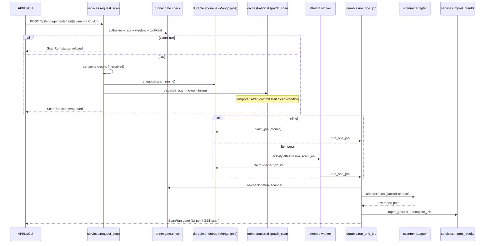

# Worker and Job Orchestration Audit

Evidence-based audit of Attestra’s CLI worker, durable job system, scanner execution, schedules, Temporal path, retries, locking, and related background work. Scope is inspection only; no application code was changed.

Sources: `attestra/cli.py`, `attestra/jobs/*`, `attestra/orchestration/*`, `attestra/services.py#request_scan`, `attestra/runner/scanners/registry.py`, `attestra/persistence/mongo/repositories/ops.py#JobRepository`, `docs/TEMPORAL.md`, `docs/WEBHOOKS.md`, Helm worker Deployment, Dockerfile, `lat.md/runner.md`, `lat search "worker durable jobs"`.

---

## 1. Worker inventory (entry points, commands)

| Entry | How started | Role | Lock / scale |
|---|---|---|---|
| `attestra worker` (`python -m attestra.cli worker`) | CLI; Helm `command: ["attestra", "worker", ...]`; UI Start Worker (local/dev) | Default **inline** durable poller (`WorkerPool`) or **Temporal** worker when `ATTESTRA_ORCHESTRATOR=temporal` | Inline: `InstanceLock` on `DATA_DIR/.lock-worker` (single process). Temporal: no instance lock |
| `attestra serve` | CLI / Docker default CMD | API + dashboard only; **does not** run scan jobs | N/A |
| UI Start/Stop Worker | `POST /engagements/{eid}/worker/start\|stop` → `jobs/launcher.py` | Spawns detached `attestra worker`; stop via `DATA_DIR/.worker-stop` | Refused in staging/prod unless `ATTESTRA_ALLOW_UI_WORKER_START`; refused when Temporal is on |
| `attestra scan` | CLI | Calls `services.request_scan` (enqueue only; needs a running worker) | Same queue as API/UI |
| Cron-style CLI jobs (not the durable scan worker) | `attestra cert-expiry-check`, `attestra purge`, `attestra enrich --refresh`, `attestra backup` | One-shot ops; must be scheduled externally | No durable `jobs` row |
| Webhook dispatch | `POST /api/webhooks/dispatch` | Claims/sends due webhook deliveries | **Not** wired into `WorkerPool` housekeeping |

Console script: `attestra = attestra.cli:main` (`attestra.egg-info/entry_points.txt`).

Worker CLI flags: `--poll` (default 2s; Temporal sweep uses `max(poll, 5)`), `--concurrency` (or `ATTESTRA_WORKER_CONCURRENCY`, default 2, max 8).

Startup always calls `config.validate_runtime_config()` and `db.init(use_migrations=True)` (Mongo).

---

## 2. Job types and registration

### 2.1 Durable scan jobs (`jobs` collection / `models.Job`)

Created only through `services.request_scan` → `jobs.durable.enqueue` → `JobRepository.enqueue` (Mongo). Status lifecycle: `queued` → `running` → `done` | `failed` | `cancelled` (also scan-side `refused` / `quarantined`).

Admission also runs `runner.gate.check` before enqueue; credits are consumed once on admit when subscription enforcement is on.

### 2.2 Scanner adapters (tool registration)

Hard-coded in `attestra/runner/scanners/registry.py#_ADAPTERS`:

`trivy`, `semgrep`, `nuclei`, `zap`, `prowler`, `kube_bench`, `testssl`, `gitleaks`, `checkov`, `naabu`, `webcheck`.

Unknown tool → `KeyError` from `get_adapter`. No dynamic plugin registration.

`SERIAL_TOOLS = {"nuclei"}` in `jobs/pool.py`: worker excludes nuclei while another nuclei job is already active (shared template cache).

### 2.3 Scheduled scans

`ScanSchedule` rows; `services.enqueue_due_schedules` calls `request_scan` for due rows. Invoked from:

- `WorkerPool._housekeeping` (inline worker)
- Temporal worker `sweep`
- API `POST /api/engagements/{eid}/schedules/run-due`

### 2.4 Elite automated VAPT executions

Separate from `jobs`: `AutomatedTestExecution` with statuses `QUEUED` / `RUNNING` / …. Claimed by `WorkerPool._claim_automated` → `automated_vapt.core.orchestrator.claim_queued_execution` when `ATTESTRA_AUTOMATED_VAPT_ENABLED` is on. Stale recovery via `recover_stale_executions` (default 30m, not job heartbeat).

### 2.5 Temporal workflows / activities (optional)

Registered when `ATTESTRA_ORCHESTRATOR=temporal`:

- Workflow: `attestra.ScanWorkflow`
- Activities: `attestra.run_scan_job`, `attestra.mark_scan_cancelled`, `attestra.mark_scan_failed`

Requires optional extra `pip install -e ".[temporal]"` (`temporalio`).

### 2.6 Not BackgroundTasks / Celery / RQ / APScheduler

No FastAPI `BackgroundTasks` for scans. No Celery/RQ/APScheduler usage in application code (only a negative test monkeypatch for invalid orchestrator `"celery"`).

---

## 3. Queue / persistence mechanism

| Concern | Mechanism |
|---|---|
| Queue store | MongoDB `jobs` collection via `JobRepository` (`persistence/mongo/repositories/ops.py`). SQLAlchemy `Job` model remains as schema mapped by `MongoSession`; runtime is Mongo-only (`bootstrap.init_persistence`, `db.session` → `MongoSession`). |
| Enqueue | Insert doc `status=queued`, copy `tool` onto job for claim-time exclusion |
| Claim | `find` up to 5 queued candidates + conditional `find_one_and_update` (`status == queued` → `running`, set `worker_id`, `heartbeat_at`, `lease_token`, `$inc attempts`) |
| Heartbeat | `WorkerPool` every ~30s → `touch_heartbeats`; stale cutoff `ATTESTRA_JOB_STALE_HEARTBEAT_S` (default 120) |
| Recover | `recover_interrupted_jobs` requeues `running` with stale heartbeat (excludes this worker’s id) |
| Retry | `fail_job(retry=True)` requeues while `attempts < ATTESTRA_JOB_MAX_ATTEMPTS` (default 3). Scanner/gate/import failures often use `retry=False` via `_fail_run` |
| Cancel | `cancel_requested` on job + in-process `threading.Event` (`signal_job_cancel` / engagement kill switch) |
| Process lock | `InstanceLock` O_EXCL file under `DATA_DIR` (inline only) |
| Orchestrator switch | `ATTESTRA_ORCHESTRATOR=inline\|temporal` |

Webhook deliveries use a separate Mongo queue (`claim_due` / `dispatch_due`) with their own backoff; see gaps.

---

## 4. API → worker path

Prose path:

1. **Admit** — API `start_scan` / UI `queue_scan` / CLI `attestra scan` / schedule housekeeping all call `services.request_scan`.
2. **Gate** — refuse without queueing a runnable job (refused `ScanRun` only).
3. **Enqueue** — Mongo job + `queued` scan; Temporal optionally starts workflow after commit.
4. **Execute** — only a live `attestra worker` claims and runs; API never runs scanners in-process.
5. **Complete** — hash raw, import, `complete_job`, optional `scan.finished` webhook **emit** (queue only).

If the worker is down, scans remain `Queued` indefinitely (documented in README / SETUP_GUIDE).

---

## 5. Validation matrix

Legend: **Pass** = code + docs/tests support the claim with evidence; **Fail** = broken or contradictory path found; **Unknown** = not runtime-exercised in this audit; **N/A** = not applicable.

| # | Check | Current status | Evidence / notes |
|---|---|---|---|
| V01 | `attestra worker` starts in inline mode | Unknown | Code path clear (`cli.cmd_worker` → `WorkerPool`); not started in this audit |
| V02 | `attestra serve` does not execute scan jobs | Pass | Serve only runs uvicorn; enqueue via `request_scan` only |
| V03 | API admit → Mongo job row | Pass | `services.request_scan` → `durable.enqueue` → `mongo_enqueue_job` |
| V04 | Worker claims queued jobs atomically | Pass | Conditional update on `status==queued`; covered by `tests/jobs/test_durable.py` / mongo jobflow tests (presence) |
| V05 | Gate re-check at run / resume | Pass | `run_one_job` + `resume_queued_jobs` call `gate.check` |
| V06 | Scanner adapters registered for documented tools | Pass | `registry._ADAPTERS` lists 11 tools matching README |
| V07 | Digest-pinned images required for Docker scanners | Pass | Placeholder digests in config; `image_is_placeholder` / `unavailable_reason` refuse unset/placeholder |
| V08 | Docker available for ZAP/etc. | Unknown | Runtime depends on host Docker + `ATTESTRA_IMAGE_*`; SETUP warns scans stay queued / tool unavailable |
| V09 | Heartbeat + stale recover | Pass | `JOB_STALE_HEARTBEAT_S`, `recover_interrupted_jobs`, lat tests section |
| V10 | Graceful shutdown requeues running jobs | Pass | `WorkerPool.shutdown` + stop file; tests in `test_worker_pool.py` / `test_worker_button.py` |
| V11 | InstanceLock prevents two inline workers | Pass | `cli.cmd_worker` exits if lock not acquired; Helm `replicas: 1`, `Recreate` |
| V12 | Temporal path when orchestrator=temporal | Unknown | Implemented + `docs/TEMPORAL.md` + `tests/jobs/test_temporal_orchestration.py` (skips without CLI/extra); not run here |
| V13 | Temporal optional dep present by default | Fail | `temporalio` only in `[project.optional-dependencies] temporal`; worker import fails if orchestrator=temporal without install |
| V14 | Scheduled scans enqueued by worker | Pass | `_housekeeping` / Temporal `sweep` call `enqueue_due_schedules` |
| V15 | Webhook deliveries auto-dispatched by worker | Fail | Docs state no background scheduler; only `POST /api/webhooks/dispatch`; worker does not call `dispatch_due` |
| V16 | Cert-expiry / purge / feed refresh auto-run | Fail | CLI one-shots only; no worker/cron registration in-process |
| V17 | Automated VAPT claimed by same worker | Pass (code) / Unknown (runtime) | `_claim_automated` gated by feature flag; not exercised here |
| V18 | Kill switch / single-scan cancel | Pass | `signal_engagement_cancel` / `request_cancel` + Event; lat + cancel tests |
| V19 | Credits charged once at admit, not in worker | Pass | Comment + logic in `request_scan`; refund on pre-start enqueue failure |
| V20 | Mongo replica set required for worker | Unknown | Default URI includes `replicaSet=rs0`; worker needs reachable Mongo matching API |
| V21 | Dockerfile HEALTHCHECK suitable for worker role | Fail | HEALTHCHECK hits `http://127.0.0.1:8000/` — fails for `attestra worker` containers using same image without override |
| V22 | Helm worker shares data PVC / Mongo env with API | Pass (design) | Same image/env helpers; worker mounts `/data`; not cluster-verified here |
| V23 | Multi-replica inline workers safe | Fail (by design) | InstanceLock + Helm note keep replicas at 1; Mongo claim would allow multi-process but lock forbids it |
| V24 | Jobs enqueued but never executed if worker absent | Pass (expected failure mode) | Documented; no API-side fallback executor |
| V25 | No Celery/RQ/APScheduler/BackgroundTasks for scans | Pass | Grep across codebase |

---

## 6. Gaps (WORKER-G01…)

| ID | Severity | Gap | Impact |
|---|---|---|---|
| WORKER-G01 | High | **Webhook deliveries are enqueued (`emit`) but not drained by the scan worker.** Delivery requires manual/cron `POST /api/webhooks/dispatch` (`docs/WEBHOOKS.md`). | `scan.finished` and other events may sit `pending` forever in production unless external cron exists |
| WORKER-G02 | High | **Ops “daily jobs” are CLI-only** (`cert-expiry-check`, `purge`, SLA email entrypoints, feed refresh). Not registered in `WorkerPool` housekeeping. | Expiry alerts / retention / enrichment drift unless operators add cron |
| WORKER-G03 | Medium | **Inline mode hard-capped to one worker process** via `InstanceLock`, even though Mongo claim is multi-worker-safe. | Throughput limited to one process × concurrency (max 8 threads); horizontal scale needs Temporal or lock redesign |
| WORKER-G04 | Medium | **Temporal is optional and easy to misconfigure**: `ATTESTRA_ORCHESTRATOR=temporal` without `.[temporal]` or a live Temporal server → worker cannot start / jobs stay queued until sweep can connect. | Jobs enqueued, workflows not started |
| WORKER-G05 | Medium | **Scanner images ship as VERIFY placeholder digests**; Docker mode refuses until `ATTESTRA_IMAGE_<TOOL>` is set. | Worker “runs” jobs that immediately fail with unavailable_reason |
| WORKER-G06 | Medium | **Dockerfile HEALTHCHECK assumes API** (`:8000`). Worker Deployment reuses image without a distinct probe. | K8s may kill/restart healthy workers if a generic probe is applied |
| WORKER-G07 | Medium | **Worker creating Kubernetes scanner Jobs is not implemented** (`deploy/README.md`: “Not done yet”). Scanners still `docker run` from the worker node. | Worker needs Docker socket / privileged access; contradicts eventual Job-per-scan network isolation |
| WORKER-G08 | Low | **Temporal coverage is scan-only**; engagement chain (triage, report, retest) not workflows (`docs/TEMPORAL.md` “Not done yet”). | Orchestrator name oversells full engagement automation |
| WORKER-G09 | Low | **Automated VAPT stale recovery uses `started_at` age**, not heartbeats; long legitimate runs risk requeue if `AUTOMATED_VAPT_STALE_S` too low. | Possible duplicate/parallel elite runs |
| WORKER-G10 | Low | **UI worker start disabled outside local/dev** (correct for prod) but easy for operators to forget a managed worker → silent queue buildup. | Operational, not a code bug; status endpoint helps |
| WORKER-G11 | Info | SETUP_GUIDE still mentions SQLite/Postgres paths while runtime bootstrap is **Mongo-only**. | Wrong DB assumptions when bringing up workers |
| WORKER-G12 | Info | SQL `jobs` table model remains in `models.py` but durable path is Mongo write-through (`MongoJob`). | Confusion for operators grepping SQL; dual mental model |

---

## 7. Docker / compose services needed for workers (proposal)

Minimal local/prod-shaped stack so API admit → worker complete works:

| Service | Required? | Purpose |
|---|---|---|
| **mongo** (replica set `rs0`) | **Yes** | Job queue, scan runs, webhooks, identity; default URI expects replica set |
| **attestra-api** | **Yes** | `attestra serve`; admits scans |
| **attestra-worker** | **Yes** | `attestra worker --poll 2`; same image, shared `ATTESTRA_DATA_DIR` / Mongo env, **Docker socket** (or DinD) until K8s Job dispatch exists |
| **Docker engine** on worker host | **Yes** (for ZAP/nuclei/etc.) | Adapters call `docker run` when images configured |
| **temporal** (+ optional UI) | Only if `ATTESTRA_ORCHESTRATOR=temporal` | Frontend `:7233`; install `.[temporal]` on API and worker |
| **cron / side-car** | **Recommended** | `POST /api/webhooks/dispatch` on an interval; `attestra cert-expiry-check`; `attestra purge` as policy requires |
| **Postgres** | **N/A** for current Mongo-only runtime | Legacy docs only |
| **Keycloak / Vault** | Optional | OIDC / secrets backend; not required for job loop itself |

Suggested worker container env (non-secret names only):

- `ATTESTRA_MONGODB_URI`, `ATTESTRA_MONGODB_DB`
- `ATTESTRA_DATA_DIR=/data`
- `ATTESTRA_ORCHESTRATOR=inline` (or `temporal` + `ATTESTRA_TEMPORAL_*`)
- `ATTESTRA_WORKER_CONCURRENCY` (1–8)
- `ATTESTRA_IMAGE_ZAP`, `ATTESTRA_IMAGE_NUCLEI`, … (real digests)
- Feature flags as needed: `ATTESTRA_AUTH_WEB_ENABLED`, `ATTESTRA_AUTOMATED_VAPT_ENABLED`

Helm today: worker Deployment enabled, `replicas: 1`, Recreate strategy, shared chart env — keep at 1 for inline; for Temporal, raise replicas only after confirming InstanceLock is skipped (Temporal path does not take the lock).

---

## Summary

Attestra’s scan execution path is coherent: **API/CLI/UI admit through `request_scan`, persist a Mongo durable job, and a separate `attestra worker` claims and runs adapters** (`run_one_job` → import). Inline mode uses a file **InstanceLock** and an in-process **WorkerPool** (heartbeats, stale recover, schedule enqueue, optional automated VAPT). Temporal is a real optional alternate that reuses the same job rows and `run_one_job`, but depends on an extra package and a Temporal server.

The largest orchestration holes are **not** missing scan registration: they are **background work that is enqueued or documented but never drained by the worker** — especially **webhook `dispatch_due` (WORKER-G01)** and **CLI-only daily/ops jobs (WORKER-G02)** — plus **placeholder scanner images (WORKER-G05)** and **API-oriented container healthchecks (WORKER-G06)**. Without a running worker (and Docker + real images), jobs correctly stay queued; that is expected, not a silent registration bug.

**This audit did not start processes or run pytest**; matrix cells without live proof are marked Unknown, not Pass.
